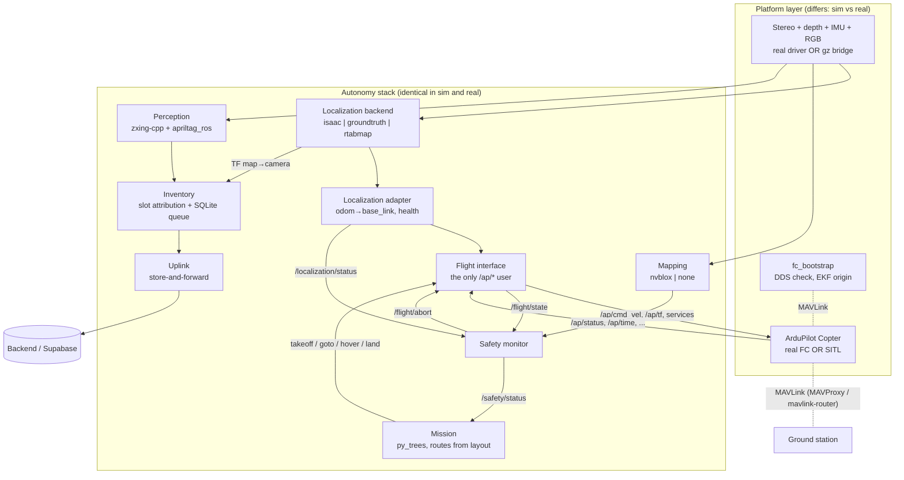

# Architecture

An autonomous indoor drone flies a predefined route through warehouse aisles, stops at every shelf
slot, reads barcodes / QR codes / AprilTags, ties each read to a rack slot, lands, and syncs the
results to a backend that a separate team's Companion App reads.

## Layers

**Platform** (`sim/`, `real/`): sensors, the flight controller, and how they are reached. In sim:
Gazebo Harmonic, ArduPilot SITL (JSON physics, lock-step), ros_gz bridges remapped to the canonical
topics, the micro-ROS agent over UDP. On the vehicle: camera driver, micro-ROS agent on a serial
port, mavlink-router. Both run `inv_tools/fc_bootstrap`, which makes sure the FC's DDS link came up
and sets the EKF origin (there is no GPS indoors).

**Autonomy** (`drone/src/`): one copy of every node; `drone.launch.py platform:=sim|real` only
changes parameters. Packages and what they own:

| Package | Owns |
|---|---|
| `inv_interfaces` | messages, services, actions |
| `inv_description` | URDF; sensor extrinsics (source of truth) |
| `inv_layout` | warehouse layout model: slots, tags, hover points (shared by mission, inventory, worldgen) |
| `inv_localization` | backends + the adapter that feeds the FC and reports health |
| `inv_mapping` | nvblox config, corridor-blocked check (`none` backend in phase 1) |
| `inv_perception` | barcode/QR (zxing-cpp) and AprilTag (apriltag_ros) detection |
| `inv_inventory` | item vs location labels, slot attribution, SQLite queue |
| `inv_mission` | route generation, behaviour tree |
| `inv_flight_interface` | everything that talks to the FC |
| `inv_safety` | health aggregation, abort |
| `inv_uplink` | backend sync, CSV export |
| `inv_tools` | FC bootstrap, EKF origin, parameter diff, bag recording |
| `inv_bringup` | `drone.launch.py` |

## Decisions that shape the code

1. **Swappable localization** (ADR 0004). Every backend publishes TF `map→odom→base_link` and
   `/localization/odom`. `groundtruth` (sim) lets anyone develop without a GPU; `isaac` runs on the
   Jetson; `rtabmap` is the CPU fallback (stub).
2. **The localization adapter** (fixes gaps 1 and 3 of the team's first diagram): it re-expresses
   whatever the backend outputs as `odom→base_link`, publishes it at a steady 30 Hz on
   `/localization/external_nav`, and stops publishing when tracking is lost, so the EKF times out
   instead of fusing stale data. `VISO_POS_*` stay 0 because base_link is the FC body frame.
3. **One gateway to the FC** (ADR 0003, gap 4). The mission never commands `/ap/cmd_vel`; it calls
   `/flight/*` actions. The flight interface owns arm/mode/takeoff, a closed-loop go-to on our own
   localization, the velocity watchdog, the mission heartbeat watchdog, a box geofence from the
   warehouse layout, and pilot-override detection: if anyone else changes the mode (RC safety pilot,
   GCS, FC failsafe), the stack stops commanding until the vehicle is disarmed.
4. **Safety monitor** (gap 5): battery, localization, FC link and corridor status → OK/WARN/ABORT;
   ABORT calls `/flight/abort` (hold, then land). The RC safety pilot always wins.
5. **Time** (gap 6): sim uses `/clock` from Gazebo and `use_sim_time`. On the vehicle, chrony keeps
   the Jetson on UTC. The FC runs on its boot clock, so the flight interface converts external-nav
   stamps into it (docs/ardupilot.md, "External navigation timestamps").
6. **EKF origin** (gap 7): set over MAVLink by `fc_bootstrap` from the layout's `geodetic_origin`,
   on both platforms.
7. **Label-based slot attribution** (ADR 0006): an item belongs to the slot whose location label is
   nearest to it in the same (or a nearby) frame; the SLAM pose is only a fallback.
8. **Store-and-forward uplink** (ADR 0008, gap 2): flight never waits on the network.
9. **One layout file drives everything**: `config/warehouses/<name>.yaml` → sim world, route,
   attribution, ground truth.

## What happens in a scan mission

1. `fc_bootstrap` confirms DDS and sets the EKF origin; the EKF starts fusing external nav.
2. The flight interface learns the FC's map-frame rotation from the yaw it reports (+90° at
   Copter-4.7.2) and allows takeoff only after that.
3. The mission waits for FC link, EKF origin, external nav and TRACKING localization; then takeoff →
   for each aisle: entry, every slot of each rack face level by level (serpentine), exit → home → land.
4. At each hover point the label camera sees one slot: its location tag on the beam and the item's
   QR on the box. Perception publishes both with the image stamp; inventory groups them, attributes
   the item, writes a scan record to SQLite and publishes `/inventory/items`.
5. The uplink syncs records whenever it can and exports a CSV; in sim `sim/evaluation` scores the
   run against the generated ground truth.

## Phase 2 (stubs marked `TODO(phase-2)` in the code)

nvblox corridor check, Isaac GPU AprilTags, rtabmap backend, Isaac VSLAM status relay, HTTP backend
for the uplink, deduplication/confidence fusion, retries and richer failsafe branches in the
mission, 1D barcode labels in sim.
